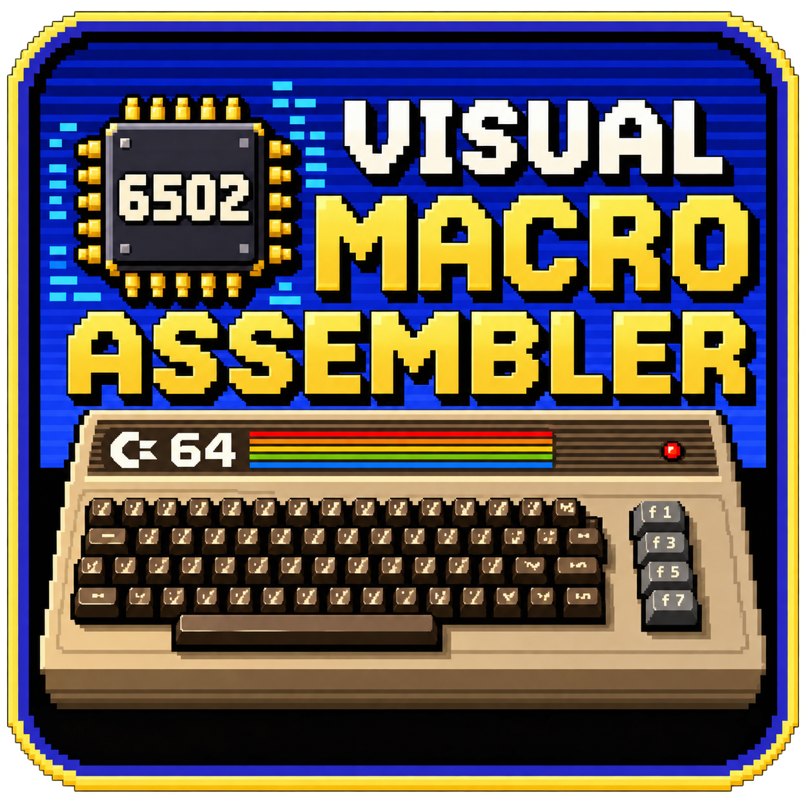

# VMA - Visual Macro Assembler
<p align="center">
  
</p>
<!-- badges:start -->
<p align="center">
  <a href="https://www.c64va.pro/"></a>
  <a href="https://github.com/zstarczali/VMA/releases/latest"></a>
  <a href="https://github.com/zstarczali/VMA/actions/workflows/release.yml"></a>
  <a href="https://github.com/zstarczali/VMA/blob/main/LICENSE"></a>
  <a href="https://www.c64va.pro/register/donate.php"></a>
</p>
<p align="center">
  <a href="https://www.rust-lang.org/"></a>
  <a href="https://en.wikipedia.org/wiki/Commodore_64"></a>
  <a href="https://www.rust-lang.org/tools/install"></a>
  <a href="https://github.com/zstarczali/VMA/commits/main"></a>
  <a href="https://github.com/zstarczali/VMA/graphs/commit-activity"></a>
  <a href="https://github.com/zstarczali/VMA/issues"></a>
  <a href="https://github.com/zstarczali/VMA/stargazers"></a>
</p>
<p align="center">
  <a href="https://github.com/zstarczali/VMA/blob/main/docs/VMA-Manual.md"></a>
  <a href="https://github.com/zstarczali/VMA/blob/main/docs/VMA-Manual.hu.md"></a>
  <a href="https://www.c64va.pro/"></a>
  <a href="https://github.com/zstarczali/UltimateBasic"></a>
</p>
<!-- badges:end -->

Version 2.3.0.

2.3.0: `--analyze FILE` writes the app's analysis (the `--json` answer plus the listing of every line, also when
the build fails): the C64 Visual Assembler has no compiler of its own any more and reads every view from it. A
local label is taken as an absolute operand too (`JMP Second.lp`, `LDA .lp+1,X`); before, it was an invalid operand.

2.2.0: `.u64_palette "file.vpl"`, `.u64_palette_color index, $RRGGBB` and `.u64_palette_reset` set the
video palette of an Ultimate 64 / C64 Ultimate through its Command Interface (firmware 3.15+).

2.1.1: a source's own BASIC SYS line at `$0801` is found when it comes after the code (as Restore64
disassemblies write it, with a label in front) and stays at `$0801`; before, it was moved over the first 12 bytes of
the code.

The 6502 / 6510 assembler of [C64 Visual Assembler](https://github.com/zstarczali/VisualAssembler), in Rust:
a library (`vma`) and a command-line compiler (`vma build`).


It assembles the VMA language — the Expert-mode text of Visual Assembler — byte for byte like the
app's JavaScript compiler: instructions (with the NMOS illegal opcodes and their aliases), labels
(local `.name`, anonymous `-` / `+`, self-modifying `label:#$00`), expressions with `*` as the
program counter, `.byte` / `.word` / `.text` / `.fill` / `.align`, `.const` / `.define` / `.if` /
`.assert`, `.var`, long branches (`LBNE` …), user macros (`.macro` … `.endm`, Kick-style `{ }`), and
every library macro of the app (TEXT, PRINT, SPRITE_*, JOYSTICK, MOUSE, MEMCPY / MEMSET, REU_*,
runtime `.if` / `.while` / `.repeat`, DELAY, INCBIN, KOALA, SID, SID_PLAYER, LEVEL, LEVEL_ROW,
INCLUDE …). A KickAssembler project reaches it through the app's Kick preprocessor, whose output is
VMA text.

## Manual

The language manual: [English](docs/VMA-Manual.md) · [Magyar](docs/VMA-Manual.hu.md) — source format, numbers and
expressions, addressing modes, the 6502 instructions, every directive and library macro, the KickAssembler-style
syntax, the command line and the known limitations.

## Command line

Ready-made `vma` binaries for Windows x64 / ARM64, macOS x64 / ARM64 and Linux x64 are on the
[Releases](https://github.com/zstarczali/VMA/releases) page, with this README and the manuals as PDF (built by
`.github/workflows/release.yml`, started by hand).
Or build it yourself:

```bash
cargo build --release
target/release/vma build game.asm -o game.prg
target/release/vma build game.asm --debug          # game.prg + .sym / .vs / .dbg
target/release/vma build game.asm --no-basic-stub  # no 10 SYS line
target/release/vma build game.asm --crt game.crt   # Magic Desk cartridge
target/release/vma build game.asm --d64 --add music.prg  # 1541 disk image, no c1541 needed
target/release/vma --help
```

Files named by `.incbin` / `.koala` / `.level` / `.u64_palette` / `.sid` / `.include` are looked up in the folder of
the input (`--base-dir`), then in every `--search` folder.

## Library

```rust
let prg = vma::build_with_files(&source, &vma::BuildOptions::default(), &vma::DirFiles { bases: vec![dir] })?;
```

`build_result` adds what the app reads besides the PRG: the debugger files, the symbols, the
laid-out lines, the written segments and the memory view; errors carry the app's translation key
(`CompileError::key` / `params`).

## Tests

`cargo test` runs the unit tests. The byte-for-byte contract is checked in the Visual Assembler
repository: its golden corpus (`tests/vma-golden`, every sample, template, palette macro, opcode and
the Kick fixtures) is built by the JavaScript compiler and by this CLI (`VMA_BIN=…/vma npm test`,
`node scripts/vma-rust-report.js`).

## License

GPL-3.0-or-later, like C64 Visual Assembler.
