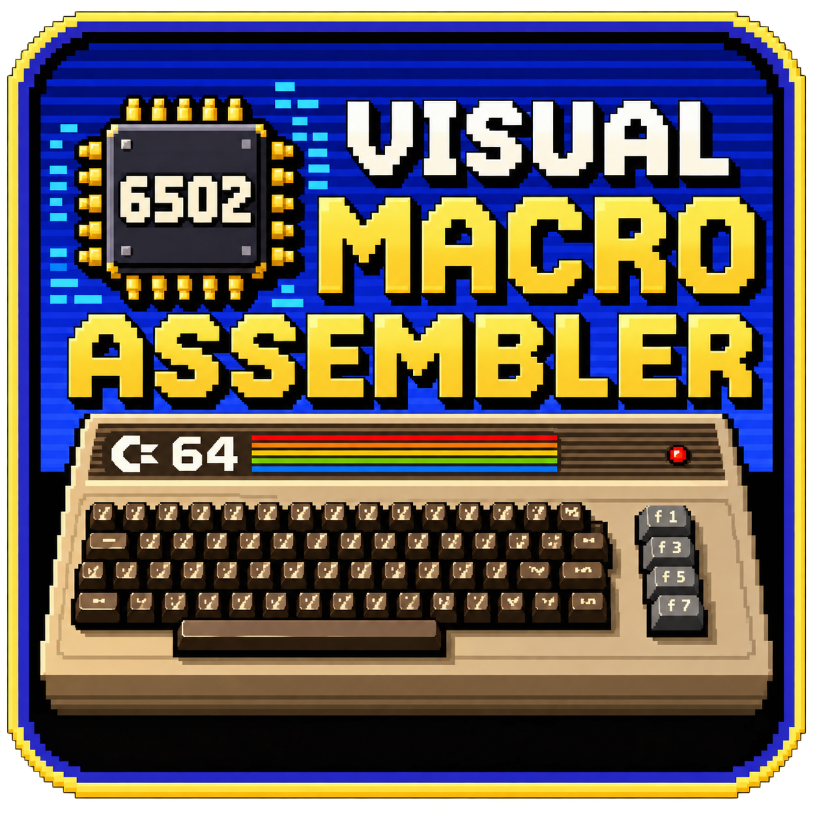

# VMA - Visual Macro Assembler

Version 2.0.0.

The 6502 / 6510 assembler of [C64 Visual Assembler](https://github.com/zstarczali/VisualAssembler), in Rust:
a library (`vma`) and a command-line compiler (`vma build`).



It assembles the VMA language — the Expert-mode text of Visual Assembler — byte for byte like the
app's JavaScript compiler: instructions (with the NMOS illegal opcodes and their aliases), labels
(local `.name`, anonymous `-` / `+`, self-modifying `label:#$00`), expressions with `*` as the
program counter, `.byte` / `.word` / `.text` / `.fill` / `.align`, `.const` / `.define` / `.if` /
`.assert`, `.var`, long branches (`LBNE` …), user macros (`.macro` … `.endm`, Kick-style `{ }`), and
every library macro of the app (TEXT, PRINT, SPRITE_*, JOYSTICK, MOUSE, MEMCPY / MEMSET, REU_*,
runtime `.if` / `.while` / `.repeat`, DELAY, INCBIN, KOALA, SID, SID_PLAYER, LEVEL, LEVEL_ROW,
INCLUDE …). A KickAssembler project reaches it through the app's Kick preprocessor, whose output is
VMA text.

## Manual

The language manual: [English](docs/VMA-Manual.md) · [Magyar](docs/VMA-Manual.hu.md) — source format, numbers and
expressions, addressing modes, the 6502 instructions, every directive and library macro, the KickAssembler-style
syntax, the command line and the known limitations.

## Command line

```bash
cargo build --release
target/release/vma build game.asm -o game.prg
target/release/vma build game.asm --debug          # game.prg + .sym / .vs / .dbg
target/release/vma build game.asm --no-basic-stub  # no 10 SYS line
target/release/vma --help
```

Files named by `.incbin` / `.koala` / `.level` / `.sid` / `.include` are looked up in the folder of
the input (`--base-dir`), then in every `--search` folder.

## Library

```rust
let prg = vma::build_with_files(&source, &vma::BuildOptions::default(), &vma::DirFiles { bases: vec![dir] })?;
```

`build_result` adds what the app reads besides the PRG: the debugger files, the symbols, the
laid-out lines, the written segments and the memory view; errors carry the app's translation key
(`CompileError::key` / `params`).

## Tests

`cargo test` runs the unit tests. The byte-for-byte contract is checked in the Visual Assembler
repository: its golden corpus (`tests/vma-golden`, every sample, template, palette macro, opcode and
the Kick fixtures) is built by the JavaScript compiler and by this CLI (`VMA_BIN=…/vma npm test`,
`node scripts/vma-rust-report.js`).

## License

GPL-3.0-or-later, like C64 Visual Assembler.
